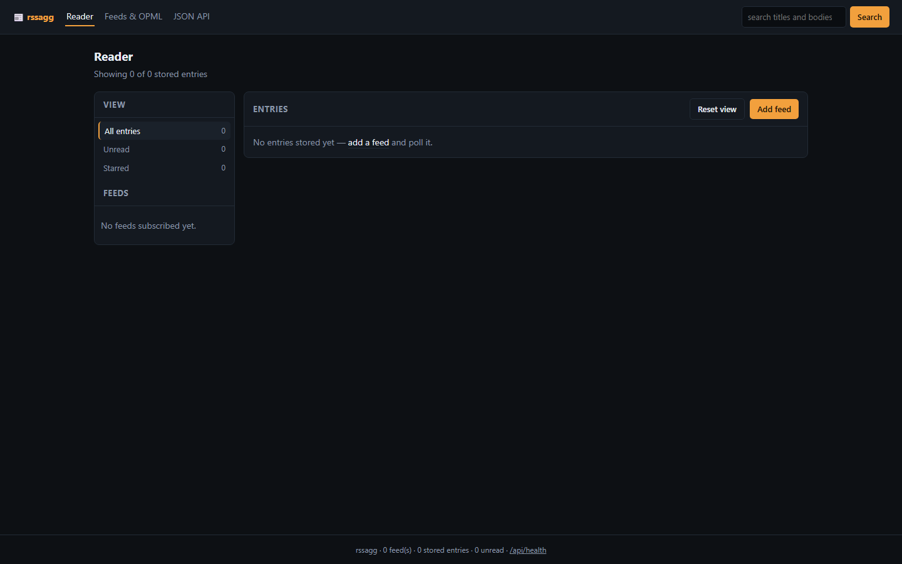
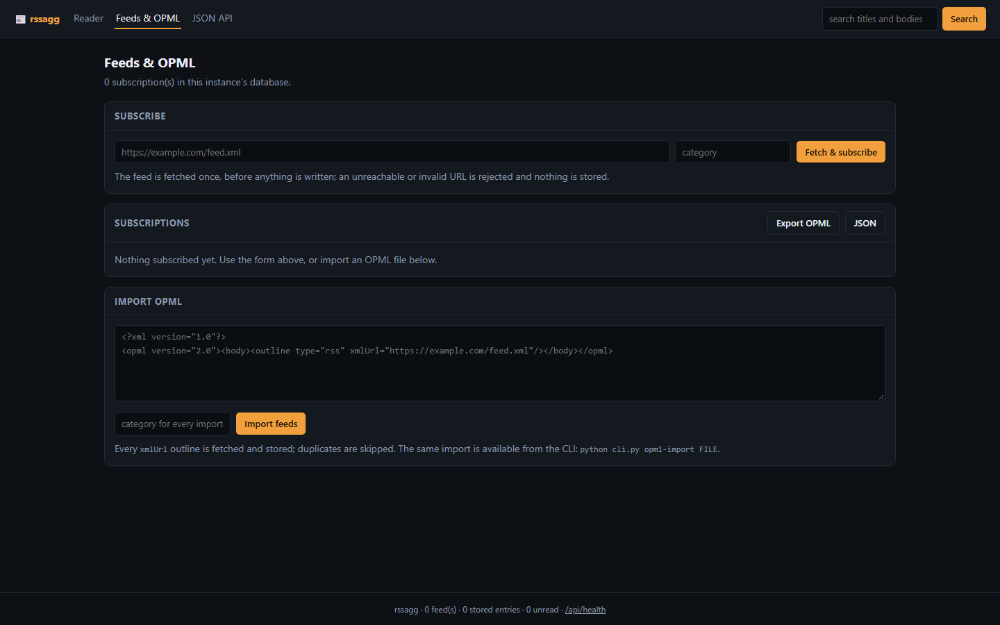
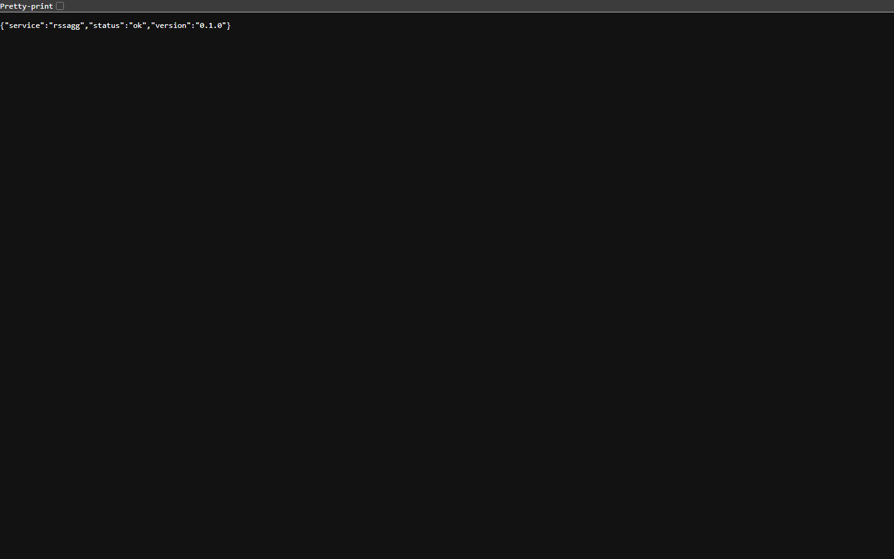
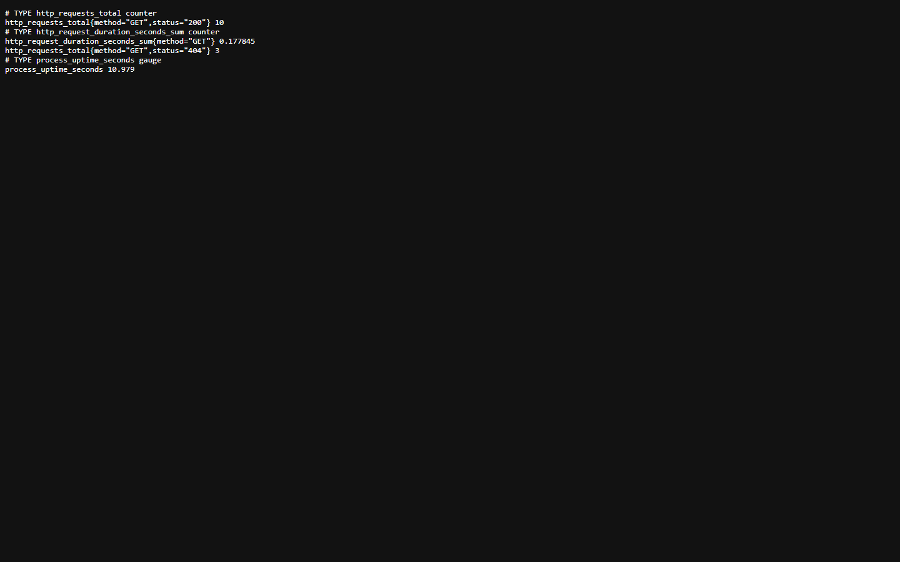
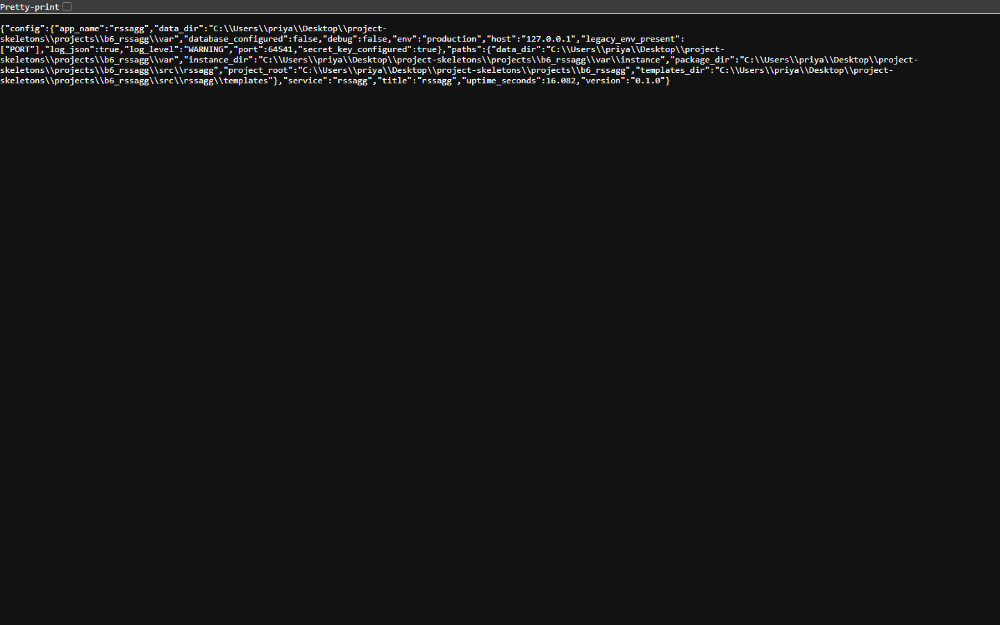

<p align="center">
  
</p>

<h1 align="center">feedhive</h1>

<p align="center"><b>Subscribe by URL, poll on a schedule, read and search in one place.</b></p>

<p align="center">
  <a href="https://github.com/scar8969/feedhive/actions/workflows/ci.yml"></a> <a href="#quality-gates"></a> <a href="#quality-gates"></a> <a href="#api"></a> <a href="#requirements"></a> <a href="LICENSE"></a>
</p>

feedhive fetches the feeds you add, parses them with feedparser, deduplicates entries by GUID, and gives you read/star state, search and OPML import/export.

---

**Contents** &nbsp;·&nbsp; [Why](#why-this-exists) &nbsp;·&nbsp; [What it does](#what-it-does) &nbsp;·&nbsp; [Quickstart](#quickstart) &nbsp;·&nbsp; [Screenshots](#screenshots) &nbsp;·&nbsp; [API](#api) &nbsp;·&nbsp; [CLI](#cli) &nbsp;·&nbsp; [Configuration](#configuration) &nbsp;·&nbsp; [Measured](#measured-not-estimated) &nbsp;·&nbsp; [How a request flows](#how-a-request-flows) &nbsp;·&nbsp; [Architecture](#architecture) &nbsp;·&nbsp; [Quality gates](#quality-gates) &nbsp;·&nbsp; [Development](#development) &nbsp;·&nbsp; [Deploy](#deploy) &nbsp;·&nbsp; [Limits](#limits-stated-rather-than-hidden)

## Why this exists

Feed readers rot when they lose your read state or duplicate entries on every poll. Keying entries by GUID and storing read/star as rows makes polling idempotent, which is the whole game.

## What it does

| Capability | How it works |
| --- | --- |
| **Idempotent polling** | Entries are keyed by GUID, so a repeated poll inserts nothing. |
| **Read and star state** | Per-entry flags with dedicated routes for toggling them. |
| **Search** | Full-text-ish search across titles and summaries. |
| **OPML in and out** | Move a subscription list between this and any other reader. |
| **CLI** | add, poll, entries, mark, search, opml-import, opml-export. |

## Quickstart

```sh
git clone https://github.com/scar8969/feedhive.git
cd feedhive
python -m venv .venv && . .venv/bin/activate   # Windows: .venv\Scripts\activate
pip install -e ".[dev]"
python wsgi.py                                 # http://127.0.0.1:8000
```

It is up when this answers:

```sh
curl -s http://127.0.0.1:8000/api/feeds
```

## Screenshots

Captured from the running service with headless Chromium at 1440×900, one image per page, committed under [`docs/assets/screens/`](docs/assets/screens/).

<table>
<tr>
<td width="50%"><br><sub><code>/feeds</code> &middot; 47.1 KB</sub></td>
<td width="50%"><br><sub><code>/healthz</code> &middot; 8.3 KB</sub></td>
</tr>
</table>

<table>
<tr>
<td width="50%"><br><sub><code>/livez</code> &middot; 7.3 KB</sub></td>
<td width="50%"><br><sub><code>/metrics</code> &middot; 14.8 KB</sub></td>
</tr>
</table>

<table>
<tr>
<td width="50%"><br><sub><code>/readyz</code> &middot; 7.7 KB</sub></td>
<td width="50%"><br><sub><code>/version</code> &middot; 25.7 KB</sub></td>
</tr>
</table>

## API

Every route below is declared in [`openapi/feedhive.yaml`](openapi/feedhive.yaml) and exercised by the live probe recorded in [`docs/EVIDENCE.md`](docs/EVIDENCE.md).

| Method | Path | What it does |
| --- | --- | --- |
| `GET` | `/api/feeds` | list |
| `POST` | `/api/feeds` | add feed |
| `GET` | `/api/entries` | entries |
| `POST` | `/api/entries/<id>/read` | mark read |
| `POST` | `/api/entries/<id>/star` | star |
| `GET` | `/api/search` | search |

## CLI

The same operations without an HTTP client. Installed as `feedhive`, and runnable from a checkout with no install:

```sh
python -m rssagg.cli --help
```

```text
usage: cli.py [-h] <command> ...

rssagg - self-hosted RSS aggregator with full-text search

positional arguments:
  <command>
    feeds        list subscribed feeds
    add          subscribe to a feed URL
    poll         re-fetch feeds and store new entries
    entries      list stored entries
    mark         mark an entry read/unread/starred
    search       full-text search entries
    opml-import  parse an OPML subscription list
    opml-export  export subscriptions as OPML
    serve        run the web UI

options:
  -h, --help     show this help message and exit

Environment: RSSAGG_DB_URI and RSSAGG_SECRET_KEY override the database URI and the
Flask secret. See README.md.
```

## Configuration

Environment only — there is no config file. Copy `.env.example` to `.env` and edit; `APP_ENV=production` refuses to start without `SECRET_KEY`.

| Variable | Default | Meaning |
| --- | --- | --- |
| `APP_ENV` | `development` | development \| staging \| production; production enforces the secret. |
| `SECRET_KEY` | `change-me-in-production` | Session/CSRF signing key. Required when APP_ENV=production. |
| `HOST` | `0.0.0.0` | Interface the dev server binds. |
| `PORT` | `8000` | Port the dev server and the container listen on. |
| `DEBUG` | `false` | Flask debug mode. Never true in production. |
| `MAX_CONTENT_LENGTH` | `8388608` | Largest accepted request body, in bytes. |
| `DATA_DIR` | `(empty)` | Where uploaded and generated files live. |
| `INSTANCE_DIR` | `(empty)` | Where the SQLite file and instance state live. |
| `LOG_DIR` | `(empty)` | Where rotated log files are written, if file logging is on. |
| `LOG_LEVEL` | `INFO` | DEBUG \| INFO \| WARNING \| ERROR. |
| `LOG_JSON` | `true` | true emits one JSON object per line; false is human-readable. |
| `REQUEST_ID_HEADER` | `X-Request-ID` | Header echoed on every response and stamped on every log line. |
| `RSSAGG_SECRET_KEY` | `rssagg-local` | Flask session key; set it in production. |

## Measured, not estimated

Produced on this checkout by `pytest --cov` and by booting `wsgi.py` and issuing one real GET per documented path. The commands are recorded in [`docs/EVIDENCE.md`](docs/EVIDENCE.md).

| Signal | Value |
| --- | --- |
| Tests | **22 / 22 passed** (1.9 s, exit 0) |
| Line coverage | **44.5%** — 446 of 907 statements |
| Source | 15 files / 1,823 lines |
| Test code | 4 files / 233 lines |
| Documented paths | 5 in the spec, 3 GET |
| Live probe | 12 GET requests to the booted app, **12 answered 200** |
| Median latency | **5.5 ms** (single uncached request, dev server) |
| Slowest / fastest | 112.9 ms `/` / 4.2 ms `/readyz` |
| Bytes served | 13.4 KB across 12 responses |
| Screenshots | 7 captured |

## How a request flows

```text
client
  │  HTTP
  ▼
wsgi.py ──▶ rssagg/app.py:get_app()
                │  reads config once (rssagg/config.py)
                │  registers the `agg` blueprint
                ▼
           route handler
             ├──▶ rssagg/models.py        tables, via Flask-SQLAlchemy
             ├──▶ rssagg/errors.py        raises typed errors → one JSON envelope
             └──▶ rssagg/observability.py JSON log line + X-Request-ID
```

Every response carries `X-Request-ID`, and the matching log line is written once at the end of the request with the status and duration, so a report of "it failed" is one `grep` away from the traceback.

## Architecture

```
feedhive/
├── src/rssagg/
│   ├── http.py                         379  HTTP plumbing for rssagg: correlation ids, access lo
│   ├── cli.py                          311  rssagg CLI - manage feeds and entries from the termi
│   ├── _app.py                         262  
│   ├── config.py                       172  Environment-driven configuration for rssagg
│   ├── observability.py                169  Structured logging and request correlation for rssag
│   ├── agg/api.py                      131  
│   ├── app.py                          119  Application factory for rssagg
│   ├── errors.py                       108  Typed application errors and their HTTP mapping for 
│   ├── paths.py                         52  Filesystem layout for rssagg
│   ├── agg/search.py                    38  
│   ├── agg/fetcher.py                   32  
│   ├── models.py                        30  
├── openapi/feedhive.yaml                  the contract of record
├── schema/feedhive.sql                    the DDL
├── tests/                       the suite that has to stay green
├── docs/EVIDENCE.md             the recorded live route walk
├── Dockerfile                   multi-stage build
└── wsgi.py                      entry point
```

The package keeps one shape across the service: `config.py` reads the environment once, `observability.py` emits structured JSON logs carrying a request id, `errors.py` turns exceptions into a single JSON envelope, `models.py` holds the tables, and the `agg/` package holds the routes.

## Quality gates

| Gate | Command | Threshold |
| --- | --- | --- |
| Suite | `pytest -q` | all green |
| Coverage | `pytest --cov` | floor in `pyproject.toml`, set below the measured value |
| Lint | `ruff check src tests` | zero findings |
| Format | `ruff format --check src tests` | zero reformats |
| Types | `mypy src` | zero errors |
| Security | `bandit -c pyproject.toml -r src` | reviewed skip list, no unreviewed finding |
| Live routes | boot `wsgi.py`, one GET per documented path | no 5xx, no undocumented guard |

CI runs the first six on Python 3.11, 3.12 and 3.13 on every push to `main`, plus a container build — [`.github/workflows/ci.yml`](.github/workflows/ci.yml).

## Development

```sh
pip install -e ".[dev]"
python -m pytest -q                      # the suite
python -m pytest --cov                   # with the coverage floor
python -m ruff check src tests           # lint
python -m ruff format --check src tests  # formatting
python -m mypy src                       # types
python -m bandit -c pyproject.toml -r src  # security
pre-commit install                       # the same checks on commit
```

Dependabot opens grouped PRs for the dev tooling weekly and for actions and the base image monthly.

## Deploy

```sh
docker build -t feedhive .
docker run --rm -p 8000:8000 --env-file .env.example feedhive
```

A `docker-compose.yml` is included for a local run with a volume for the SQLite file. The image runs as a non-root user and serves through gunicorn.

## Limits, stated rather than hidden

- Fetches on demand or on a CLI poll; the scheduler is opt-in.
- Feed parsing depends on feedparser, which is vendored only for the offline test host.

## License

MIT — see [LICENSE](LICENSE).
